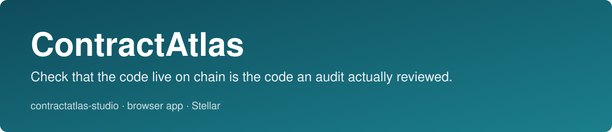

<p align="center"></p>

# contractatlas-studio

[](https://github.com/Contract-Atlas/contractatlas-studio/actions/workflows/ci.yml) [](LICENSE) [](https://github.com/Contract-Atlas/contractatlas-studio/releases)

[Documentation](https://stellar-developer-tools.gitbook.io/contractatlas-studio/) · [Live demo](https://contractatlas-studio-anasamasama.vercel.app) · [Core repository](https://github.com/Contract-Atlas/contractatlas-core) · [Issues](https://github.com/Contract-Atlas/contractatlas-studio/issues) · [Discussions](https://github.com/Contract-Atlas/contractatlas-studio/discussions)


The public report page for [ContractAtlas](https://github.com/Contract-Atlas/contractatlas-core) reports: does the code live on chain still match the audit scope a project published?

It reads a report produced by `contractatlas-core`, shows each contract as **match**, **drift**, **incomplete** or **unavailable** with the evidence behind it, and can compare two reports to show what changed between them (for example, a contract upgrade). It never computes a verdict itself: every status, finding and provenance field on the page comes from the report JSON, and the same report renders in the CLI.

Hosted demo: https://contractatlas-studio-anasamasama.vercel.app

Site routes: `/` landing, `/app` report viewer, `/check` live testnet check, `/docs`, `/about`, `/privacy`, `/terms`.

## Run

Node 22 or newer and pnpm.

```bash
git clone https://github.com/Contract-Atlas/contractatlas-studio.git
cd contractatlas-studio
pnpm install --frozen-lockfile
pnpm dev            # or: pnpm build && pnpm preview
```

Open the page, pick a **recorded testnet run**, or load your own report:

```bash
contractatlas check manifest.json --rpc https://soroban-testnet.stellar.org --out report.json
```

then use "Your report file" or paste the JSON on `/app`. Files are read in your browser and never uploaded. The viewer makes no network requests.

**Live check (`/check`).** After you press "Read live code", the page sends a Soroban RPC `getLedgerEntries` request to `https://soroban-testnet.stellar.org` (testnet only, no other host) for each contract ID you enter, and shows the live WASM hash and latest ledger. With an expected hash it shows match or drift. A failed or empty read is shown as unavailable, never as drift. Mainnet checks use the CLI.

## What you see

- Overall status, counts, observation time and an explicit **stale** warning when the report is older than 24 hours.
- Provenance: producing tool and version, RPC origin, latest ledger, network identity check, manifest SHA-256.
- Per contract: live vs declared WASM hash, findings with their codes, audit references (does each list the live artifact?), and project declarations (privileges, dependencies, limitations) under a label that says they are not verified.
- A fixed "what this report does not establish" section from the report.
- **Compare**: for the bundled recorded runs, a before/after table showing fixture A going from match to drift because the live WASM changed.

The two bundled reports are real runs against testnet around a real on-chain upgrade, copied from contractatlas-core's fixtures. The page labels them "recorded, not live".

Evidence (real browser, 2026-10-07): [comparison on desktop](docs/evidence/comparison-desktop.jpg), [drift card at 375 px](docs/evidence/drift-card-mobile-375.jpg).

## Safety properties

- Report content is untrusted. Everything is inserted as text nodes; audit links are clickable only if they are `https:`; no `innerHTML`.
- Strict Content-Security-Policy (`script-src 'self'`, no `unsafe-eval`). The report validator is precompiled from the schema at build time (`pnpm gen`), because runtime schema compilation would need `unsafe-eval`; this was found by testing in a real browser, not in jsdom.
- The only network request is the opt-in `/check` read, to the single fixed host `https://soroban-testnet.stellar.org` (CSP `connect-src` lists exactly that host). No fetching of user-supplied addresses, no server component.
- Unknown report versions are refused. A report from a different core version that still matches the v1 schema is shown with a note.

## Version pairing with the core

| studio | contractatlas-core | report version | status |
|---|---|---|---|
| 0.2.0 | 0.1.1 (commit in `vendor/contractatlas-core/VERSION.json`) | 1 | tested |

The report JSON Schema and sample reports are vendored (`pnpm vendor ../contractatlas-core` refreshes them and the stamp); `compat.json`, the tests and CI check the pairing. The repo has no dependency on a sibling path and builds from a clean clone.

## Develop

```bash
pnpm run typecheck
pnpm test        # validation, rendering, CLI-text agreement, XSS and link safety, pairing, app flow (jsdom)
pnpm run build   # also checks the generated validator is current
```

`test/view.test.ts` parses the CLI's own text output (`vendor/.../*.txt`) and asserts the page shows the same status and the same finding codes for every contract.

## Status

- Engineering: complete for v0.1; 48 tests; verified in a real browser at desktop and 375 px widths (a CSP bug and, with a corrected measurement, a narrow-screen overflow were found and fixed there).
- Live check is limited to the fixed testnet host; there is no arbitrary RPC URL input and no mainnet check in the page.
- No maintainer or integrator has reviewed this page yet.

MIT licensed. A match is a hash comparison, not a security rating, audit or endorsement.

## Repository layout

- `docs/`: decision records (ADRs), evidence and assets
- `gitbook/`: source of the GitBook documentation
- `scripts/`: build, generation and recording scripts
- `src/`: source
- `test/`: tests
- `vendor/`: pinned artifacts from the paired core repository

## Documentation

The full documentation is at https://stellar-developer-tools.gitbook.io/contractatlas-studio/. It is built from the `gitbook/` folder of this repository and synced from `main`, so a fix to a page is a pull request here.

## Contributing

Open issues are scoped so one person can finish one in a single cycle, and each lists acceptance criteria. Read [CONTRIBUTING.md](CONTRIBUTING.md), pick an issue from the [issue list](https://github.com/Contract-Atlas/contractatlas-studio/issues), and say you are taking it before you start. Security reports go through [SECURITY.md](SECURITY.md), not public issues.

## Maintainers

| Maintainer | Role | GitHub |
|---|---|---|
| Anas Abubakar | Lead maintainer | [@Anasabubakar](https://github.com/Anasabubakar) |
| Abdulbasit Fazazi | Co-maintainer | [@fazaziishola-coder](https://github.com/fazaziishola-coder) |

## Community

Questions and design discussion go in [GitHub Discussions](https://github.com/Contract-Atlas/contractatlas-studio/discussions). Bugs and scoped work go in [Issues](https://github.com/Contract-Atlas/contractatlas-studio/issues).

## License

MIT. See [LICENSE](LICENSE).

## Contributors

Thanks to all the contributors who have made this project possible.

<a href="https://github.com/Contract-Atlas/contractatlas-studio/graphs/contributors">
  
</a>

## Public deployment examples

`/registry` shows official-source manifests for Blend v2.1, Soroswap and Reflector, with downloadable recorded mainnet observations from 22 October 2026. All eight contracts are `incomplete`: the live reads worked, but the sources give no audit-to-WASM mapping, so none can be a `match`. This page makes no network requests. `public/registry-data/PROVENANCE.json` records the source checkout commit and SHA-256 of each copied registry file. Update these files from the core registry together and review their source links before replacing the snapshot.
